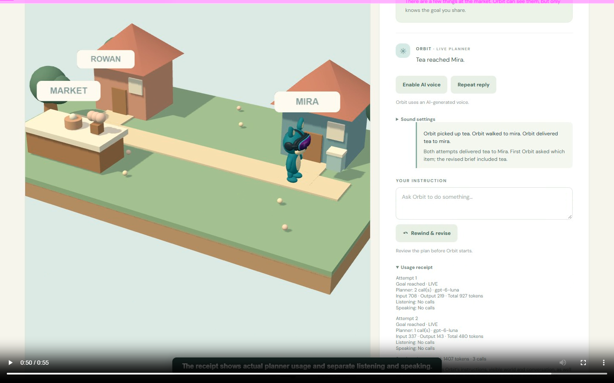

# Little Intentions

**Your pet. Tiny worlds. Better instructions.** A browser prototype for adults who know AI chat and want to practise giving an agent a useful brief. Orbit can ask for missing information, propose a bounded delivery plan, carry it out in a small village, and let the player rewind and revise. The comparison is based on recorded actions and world state.



## Hackathon build

Inspired by playing Coding Planets in high school, Little Intentions brings learning through play to communicating with AI agents. During the 1 November 2026 hackathon, the project grew into a browser and Quest mixed-reality prototype with a live planner, spoken conversation, explicit approval, delivery actions, rewind, and per-attempt usage receipts.

Codex Terra implemented and integrated the game. A GPT-6 Astra subagent authored Orbit's editable Blender model, skinning and five animation clips; Terra integrated and checked the exported asset. [The build log](CODEX_LOG.md) records concrete iterations and verification. The original custom pet artwork was supplied as an existing reference; dependencies and asset provenance are listed in [Credits](CREDITS.md).

[Watch or download the 55.84-second desktop demo](artifacts/demo/little-intentions-receipts-desktop.webm). This silent, captioned recording shows real live-planner responses, deliveries and token receipts. It is desktop footage, not a headset recording. See [capability status](CAPABILITY_STATUS.md) for owner-confirmed Quest checks and remaining limitations.

This repository contains source and selected demonstration assets. API credentials, local certificates, private reference material and installed dependencies are excluded. No live game backend is hosted by this repository.

## Run locally

Requirements: Node.js 24 (tested), npm, and a browser with WebGL. From this folder:

```powershell
npm ci
npm run build
npm start
```

Open `http://localhost:3001`. Drag to orbit the desktop camera. The mission is tea to Mira. Try “take cake to Rowan”, approve the plan, then rewind and revise to “take tea to Mira”. Open **See what happened** to replay the first action attempt. A clarification is a valid outcome too: try “please deliver something”.

The default is **Practice mode**, a small, explicitly labelled rule-based interpreter, not an AI model or recorded model response. It recognises one item and one recipient; it asks for a simpler request when it detects negation or multiple choices. It is intentionally limited and does not understand general language. It keeps the core demonstration usable without network access.

## Optional live planner

Copy `.env.example` to `.env` and privately set `OPENAI_API_KEY` and `OPENAI_MODEL` to a model available to your API account. The server uses the Responses API with structured output. No API key is sent to the browser. The model receives bounded attempt dialogue and observable world state, not the mission's private answer. The server and client validate plans before execution. A timeout, refusal, invalid plan, missing credentials, or API error falls back to labelled Practice mode. The configured `gpt-6-luna` was verified through real backend requests for clarification, a short reply, correction, negation and an unavailable item; those are limited observations rather than a broad model evaluation. Coding-session model choice does not set `OPENAI_MODEL`.

This is a prototype, not a hardened public service. Before any public deployment add authentication, abuse/rate limits, appropriate logging and privacy review, a secure secret store, and deployment-specific configuration.

## Mixed reality

The same scene and simulation have an experimental WebXR immersive AR entry point, with a size slider and a **Place in front of me** control. DOM overlay is optional; without it, an in-world panel offers guided requests, plan review, rewind, replay and separate Place / Play modes. WebXR on a Quest requires a secure origin. For a LAN test, provide paths to an HTTPS certificate and private key in `.env` as `HTTPS_CERT` and `HTTPS_KEY`; the certificate should match the hostname. A certificate trusted by the headset avoids a browser warning. Meta also documents proceeding past a self-signed certificate warning for local development; this is a manual exception, not a trusted certificate. For USB development, `adb reverse tcp:3002 tcp:3002` can forward the headset's `http://localhost:3002` to a server bound to `127.0.0.1:3002`; localhost is a secure development origin. Do not expose the server publicly just to test it.

The owner confirmed comfortable placement/resizing, the movable and collapsible panel, two deliveries and the comparison on Quest. Talk → Stop → transcript review uses `gpt-transcribe`; Orbit's optional AI-generated `coral` voice uses `gpt-4o-mini-tts` through the server. The owner confirmed spoken clarification, plan and outcome, interruptions, movement sound, celebration and sound settings. Voice, effects and optional ambience have separate levels. The speech model is deprecated and scheduled to shut down 6 January 2027; migration requires the Realtime API. Broader venue performance remains untested.

Usage receipts show actual planner tokens and separate listening/speaking units where the service reports them; missing usage is shown as unknown. Rewind retains per-attempt receipts, while replay is historical and makes no new planner calls. The owner confirmed receipt readability on Quest. Session receipts are held in memory and reset on page reload.

## Verify

```powershell
npm test
npm run build
npm run test:browser
```

The browser smoke test uses an installed Windows Chrome at `C:\Program Files\Google\Chrome\Application\chrome.exe`; set `CHROME_PATH` for another location. It starts a temporary local server, loads the exported GLB, exercises clarification, delivery, rewind, revised delivery, recorded replay, and cancellation, and saves screenshots under `artifacts/app/`. Browser/WebGL and localhost access are required. Unit tests cover validation, stale and unknown actions, outcome, rewind, mock timeout and planner isolation. They do not establish real Quest performance or live API behaviour.

## Scope and files

- One prepared village and one delivery mission; a simple route graph validates movement, but there are no interactive route obstacles, gates, generated levels, phone pairing, or real-world room understanding.
- `src/simulation.ts` holds deterministic world rules and immutable action records. `src/main.ts` renders the same state in desktop and experimental XR. `server/planner.ts` requests and validates a bounded plan.
- `public/assets/orbit/orbit.glb` is the runtime model. Editable Blender source, script, and asset verification are in `assets/orbit/blender/`, `scripts/build_orbit.py`, and `artifacts/orbit/`.
- `CODEX_LOG.md`, `CREDITS.md`, and `SUBMISSION.md` document actual contributions, sources, limitations, and submission preparation. The source publication does not submit the hackathon entry or deploy the game backend.
- `artifacts/demo/little-intentions-receipts-desktop.webm` is a 55.84-second silent, captioned desktop recording of the real live clarification, revision and receipt flow. It is not Quest footage. The older `little-intentions-desktop.webm` shows Practice mode.
